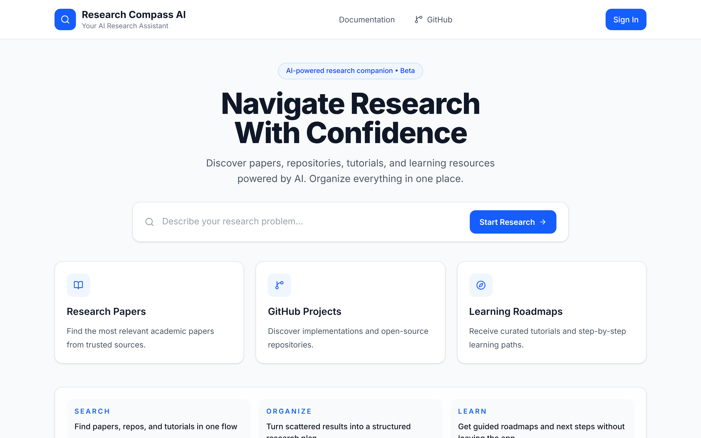

# Research Compass AI

[](https://github.com/quicklearner404/research-compassAI/actions/workflows/ci.yml)

[](LICENSE)

An agentic research assistant for AI/ML topics. Ask a question and it either
answers directly, or, for research requests ("find recent papers on RAG
evaluation", "GitHub implementations of ViT"), hands the query to a
tool-calling agent that searches **arXiv**, **GitHub** and the **web** and
writes a grounded Markdown answer that only cites what the tools returned.



## Features

- **Tool-calling agent** built on [smolagents](https://github.com/huggingface/smolagents) with three tools: arXiv paper search, GitHub repository search and DuckDuckGo web search.
- **Query routing**: general questions take a fast path straight to the LLM; research and resource requests go through the agent and its tools.
- **Citation verification**: every link in a tool-based answer is checked against what the tools actually returned. Links no tool returned are flagged under the answer as unverified.
- **Swappable LLM providers**: Hugging Face Inference, Groq or a local Ollama model, chosen with one environment variable.
- **Persistent research sessions**: a FastAPI and SQLite backend stores conversations, and the first question becomes the session title.
- **React UI**: Vite, Tailwind, Markdown rendering and Google sign-in through Firebase.
- **Offline evaluation suite**: a labelled router benchmark and citation-grounding cases, with a regression gate in CI (see [Evaluation](#evaluation)).
- **Offline test suite**: 67 deterministic tests with mocked external APIs, plus optional live smoke tests. CI runs on Python 3.11 to 3.13.

## Architecture

```text
React + Vite frontend ──REST──▶ FastAPI  (/sessions, /sessions/{id}/chat)
                                   │
                         ChatService: save message → build context
                                   │      (MemoryService, PromptService)
                                   ▼
                             ResearchAgent
                     needs_tools(query)?  ── no ──▶ LLM (direct answer)
                                   │ yes
                                   ▼
                     smolagents ToolCallingAgent
                 ┌─────────────────┼─────────────────┐
             arxiv_search     github_search      web_search
            (arxiv API)       (PyGithub)       (DuckDuckGo)
                 └─────────────────┼─────────────────┘
                                   ▼
                     LLM provider (HF / Groq / Ollama)
                                   ▼
                  Markdown answer → saved to SQLite → UI
```

Every tool implements `BaseTool.run(query) -> ToolResult` and never raises:
API failures (rate limits, timeouts) come back as `success=False` with an
error message, so a single failing source can't crash a chat request.
`hf_tools.py` wraps each tool as a smolagents `Tool`, so adding a new source
means writing one `BaseTool` subclass and registering it in `tool_registry.py`.

## Project structure

```text
backend/
  app.py               FastAPI app, CORS, table creation
  api/sessions.py      REST endpoints (sessions, messages, chat)
  agent/               ResearchAgent, routing, prompts, smolagents tool wrappers
  agent_tools/         arXiv / GitHub / web search tools (+ shared query enrichment)
  providers/           Hugging Face, Groq and Ollama model factories
  services/            chat orchestration, conversation memory, prompt building
  repositories/        SQLAlchemy data access
  models/ schemas/     ORM models and Pydantic request/response schemas
  tests/               pytest suite (offline by default)
frontend/              React + Vite app
evals/                 offline router benchmark + citation-grounding cases, report in evals/results/
scripts/run_agent.py   command-line demo of the agent
config.py              all settings, read from environment variables
```

## Quick start

**Requirements:** Python 3.11+ and Node 22+.

### 1. Backend

```bash
git clone https://github.com/quicklearner404/research-compassAI.git
cd research-compassAI
python -m venv .venv && source .venv/bin/activate   # Windows: .venv\Scripts\activate
pip install -r requirements.txt
cp .env.example .env      # then set LLM_PROVIDER and the matching key
uvicorn backend.app:app --reload
```

The API runs at http://127.0.0.1:8000, with interactive docs at `/docs`.

> **No API key?** Set `USE_MOCK_LLM=true` in `.env` to run the full app with canned responses.

### 2. Frontend

```bash
cd frontend
npm install
cp .env.example .env      # set VITE_API_URL and your Firebase web config
npm run dev
```

Open http://localhost:5173.

### 3. Command-line demo (no UI)

```bash
python -m scripts.run_agent "Find three recent Vision Transformer papers on arXiv"
```

## Configuration

All settings are environment variables (see [`.env.example`](.env.example)):

| Variable | Default | Purpose |
|---|---|---|
| `LLM_PROVIDER` | `huggingface` | `huggingface`, `groq` or `ollama` |
| `HF_TOKEN` / `HF_MODEL_ID` | – / `Qwen/Qwen2.5-72B-Instruct` | Hugging Face Inference |
| `GROQ_API_KEY` / `GROQ_MODEL` | – / `openai/gpt-oss-120b` | Groq |
| `OLLAMA_MODEL` / `OLLAMA_BASE_URL` | `qwen2.5:3b` / `http://localhost:11434` | Local Ollama |
| `AGENT_MAX_STEPS` | `1` | Maximum tool-calling steps per question |
| `GITHUB_TOKEN` | – | Optional; raises the GitHub search rate limit |
| `USE_MOCK_LLM` | `false` | Canned responses, no LLM calls |
| `DATABASE_URL` | SQLite file in the repo root | Any SQLAlchemy URL |
| `CORS_ORIGINS` | `http://localhost:5173` | Comma-separated allowed frontend origins |

## Testing

```bash
pip install -r requirements-dev.txt
pytest                                  # 67 offline tests, about 2 seconds
RUN_LIVE_TESTS=1 pytest -m live         # optional: hit the real arXiv/GitHub/DDG APIs
cd frontend && npm test && npm run lint
```

The default suite needs no network and no API keys:

- **Tools**: arXiv, GitHub and DuckDuckGo clients are replaced with fakes. Tests check result normalization, truncation, result limits, query enrichment and that API errors become `ToolResult(success=False)` instead of exceptions.
- **Agent**: routing (`needs_tools`) and dispatch, checking that general questions go to the LLM and research questions go to the tool agent, using fake models.
- **Memory and prompts**: context window, history ordering and prompt layout.
- **API**: FastAPI `TestClient` against a throwaway SQLite database, covering session CRUD, chat persistence, auto-titling, 404 handling and ordering.

CI ([`.github/workflows/ci.yml`](.github/workflows/ci.yml)) runs the backend suite on Python 3.11, 3.12 and 3.13, and lints, tests and builds the frontend on every push and pull request.

## Evaluation

```bash
python -m evals.run_evals           # writes evals/results/report.md
python -m evals.run_evals --check   # fails if any metric drops below evals/baseline.json (run in CI)
```

| Evaluation | Data | Result |
|---|---|---|
| Query router (`needs_tools`) | 60 hand-labelled queries, 30 per class | **63.3% accuracy**, F1 0.633 |
| Citation grounding (`check_citations`) | 12 answer/tool-output pairs with fabricated links | 12/12 cases, flag precision and recall 100% |

The router benchmark separates five query types, and the per-category scores show exactly where keyword routing fails:

| Category | Accuracy | What it tests |
|---|---|---|
| explicit research requests | 100% | "find recent papers on RAG" |
| general concepts and chit-chat | 100% | "What is backpropagation?" |
| **synonym** | **0%** | retrieval intent without a keyword: "Recommend *books* on deep learning" |
| **keyword overlap** | **0%** | keyword in a non-retrieval sense: "How do I *search* a binary tree?" |

Every misrouted query is listed in the [full report](evals/results/report.md) with an automatic diagnosis (vocabulary gap or keyword overlap). Half the set was written to target these two failure modes, so 63% reflects that mix, not everyday usage. It sets a measured baseline for replacing the keyword router with an LLM or embedding-based classifier, and CI blocks any change that scores lower.

## Design notes and known limitations

- **Keyword routing** is fast and predictable but crude. It fails on every synonym and keyword-overlap query in the benchmark (see [Evaluation](#evaluation)). An LLM or embedding-based router is the planned fix, measured against the same benchmark.
- **`AGENT_MAX_STEPS=1` by default.** The agent makes one round of tool calls and then answers, which keeps latency and token cost low; the prompts are tuned for this. Raise it for multi-hop research with stronger models.
- **Short memory.** Only the previous message is sent as conversation context (`MemoryService(max_recent_messages=2)`), which keeps prompts small enough for local models.
- Responses are not streamed yet.

## Roadmap

- Streaming responses
- Replace the keyword router and measure the gain on `evals/router_cases.jsonl`
- Provider fallback (for example Groq, then Hugging Face)
- PostgreSQL for deployment, and exporting reports to PDF

## License

[MIT](LICENSE)
